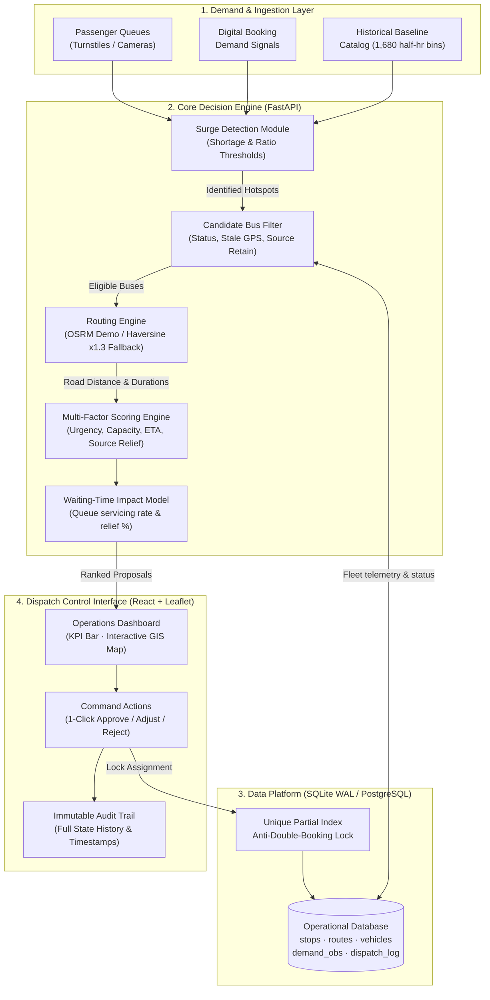

# TRINETRA — Intelligent Real-Time Bus Fleet Reallocation System

[](https://trinetra-eosin-omega.vercel.app/)
[](https://trinetra-backend-hhwu.onrender.com/health)
[](https://trinetra-backend-hhwu.onrender.com/docs)
[](LICENSE)
[](backend/tests/)

> **InnoHacks 2.0 — TechSpark 2026** | **Problem Statement ID:** E2  
> **Institution:** Madanapalle Institute of Technology and Science (MITS)  
> **Reference Domain:** Andhra Pradesh State Road Transport Corporation (APSRTC) Operational Context  
> **Environment Mode:** Simulated Data Operational Environment (`[SIMULATED DATA ENVIRONMENT]`)

---

## 📌 Executive Summary & Problem Statement

Public bus transit networks operate according to static, predetermined schedules and fixed vehicle route assignments. However, urban and suburban passenger demand fluctuates dynamically:
- **Colleges & Universities**: 150–300 students suddenly released at bell dismissal times (e.g., MITS College at 4:30 PM).
- **Railway Junctions**: Train arrivals causing instantaneous 180+ commuter spikes needing connecting transit.
- **Interchange Terminals**: Sudden queue accumulation while buses in adjacent low-demand sectors sit idle with low occupancy.

### The Operational Challenge
When a surge occurs, dispatch controllers lack real-time visibility into **where available vehicle capacity exists** across adjacent stops and **which buses can be rerouted with minimal disruption**. Traditional responses rely on manual phone calls or uncoordinated ad-hoc decisions, causing:
1. Prolonged passenger wait times (>45 minutes).
2. Bus bunching and uneven fleet utilization.
3. Over-crowding, safety concerns, and lost transit revenue.

### The TRINETRA Solution
**TRINETRA** is a demand-aware, decision-support vehicle reallocation platform. It continuously evaluates real-time queue observations and booking signals against historical baselines, detects capacity shortages, discovers eligible spare vehicles within reachable road network corridors, calculates OSRM driving ETAs, ranks options via a 4-factor composite scoring function, and presents 1-click actionable reallocation plans with guaranteed double-booking prevention.

---

## 🌐 Live Cloud Deployments

| Component | Cloud Platform | Live Endpoint URL | Description |
| :--- | :--- | :--- | :--- |
| **Command Portal** | Vercel (Edge CDN) | [trinetra-eosin-omega.vercel.app](https://trinetra-eosin-omega.vercel.app/) | Official government-grade dispatch dashboard with interactive Leaflet GIS map. |
| **Dispatch API Engine** | Render Cloud | [trinetra-backend-hhwu.onrender.com](https://trinetra-backend-hhwu.onrender.com) | FastAPI REST service executing surge detection, ranking algorithms, and SQLite WAL persistence. |
| **Interactive API Docs** | Swagger UI | [trinetra-backend-hhwu.onrender.com/docs](https://trinetra-backend-hhwu.onrender.com/docs) | OpenAPI specification with live testing console for all endpoints. |
| **Health Telemetry** | Cloud Health Check | [trinetra-backend-hhwu.onrender.com/health](https://trinetra-backend-hhwu.onrender.com/health) | Real-time cluster status, database connection, and simulation mode telemetry. |

---

## 🏛️ System Architecture

TRINETRA is architected into four decoupled, resilient operational layers:



---

## 📐 Mathematical Formulation & Core Algorithms

### 1. Demand Surge & Shortage Identification
For any transit stop $s$ at time $t$:
$$\text{CurrentDemand}(s, t) = \text{QueueCount}(s, t) + \text{BookingDemand}(s, t)$$
$$\text{SurgeRatio}(s, t) = \frac{\text{CurrentDemand}(s, t)}{\max(\text{HistoricalBaseline}(s, t), 1)}$$
$$\text{CapacityShortage}(s, t) = \max\Big(0, \, \text{CurrentDemand}(s, t) - \sum_{v \in \text{LocalBuses}(s)} \text{AvailSeats}(v)\Big)$$

A station is flagged as an active **Hotspot** if:
$$(\text{SurgeRatio} \ge 1.4 \land \text{CapacityShortage} \ge 15) \quad \lor \quad (\text{CapacityShortage} \ge 30)$$

### 2. Candidate Vehicle Filtering Constraints
A vehicle $v$ at origin stop $o$ is eligible for reassignment to target stop $d$ if and only if:
1. $\text{Status}(v) = \text{'available'}$ (not in maintenance, out of service, or assigned).
2. $\text{AvailableSeats}(v) \ge 10$ (meets minimum useful reallocation threshold).
3. $\text{Now}() - \text{LocationTimestamp}(v) \le 30 \text{ minutes}$ (guarantees fresh GPS telemetry).
4. $o \ne d$ (reallocation requires inter-hub transit).
5. $\text{RetainedSeats}(o) - \text{Capacity}(v) \ge \text{Baseline}(o) \times 0.20$ (protects origin stop from induced shortages).
6. Vehicle does not possess an active `approved` assignment in `dispatch_recommendations`.

### 3. Multi-Factor Reallocation Composite Score
Each candidate vehicle-to-hotspot pair is evaluated on a normalized scale $[0, 100]$:

$$\text{Score}(v, d) = \Big( w_u \cdot U(d) + w_c \cdot C(v) + w_e \cdot E(v, d) + w_i \cdot I(o) \Big) \times 100$$

Where normalized sub-factors are defined as:
- **Urgency Factor**: $U(d) = \min\left(1.0, \, \frac{\text{CapacityShortage}(d)}{80}\right)$
- **Capacity Match Factor**: $C(v) = \min\left(1.0, \, \frac{\text{AvailableSeats}(v)}{55}\right)$
- **Travel ETA Factor**: $E(v, d) = \max\left(0.0, \, 1.0 - \frac{\text{ETA}(v, d) \text{ [min]}}{60.0}\right)$
- **Source Area Impact**: $I(o) = \min\left(1.0, \, \frac{\text{SpareSeatsRemaining}(o)}{60.0}\right)$

**Default Production Weights:**
- $w_u = 0.35$ (Urgency of passenger crowd)
- $w_c = 0.30$ (Available seat capacity of candidate bus)
- $w_e = 0.25$ (Road transit travel time)
- $w_i = 0.10$ (Preservation of source hub service levels)

### 4. Passenger Waiting-Time Reduction Model
Before and after reallocation passenger waiting times are estimated using queue-drain dynamics:
$$\text{Wait}_{\text{baseline}} = \frac{\text{Headway}_{\text{scheduled}}}{2} + \left( \frac{\text{UnservedQueue}}{\text{BoardingRate}} \right)$$
$$\text{Wait}_{\text{projected}} = \text{ETA}_{\text{bus}} + \left( \frac{\max(0, \text{UnservedQueue} - \text{BusCapacity})}{\text{BoardingRate}} \right)$$
$$\text{ReductionPercent} = \frac{\text{Wait}_{\text{baseline}} - \text{Wait}_{\text{projected}}}{\text{Wait}_{\text{baseline}}} \times 100\%$$

---

## 🗃️ Geographical Context & Seeded Network

The prototype models the **Madanapalle / Chittoor transit corridor**, featuring 8 real-world hubs, 7 operational routes, and 12 tracked buses:

| Stop ID | Transit Hub Name | Location Type | Latitude | Longitude | Strategic Role |
| :---: | :--- | :--- | :---: | :---: | :--- |
| **1** | Madanapalle Bus Stand | Bus Stand (Depot) | 13.5500 | 78.5012 | Primary district interchange & fleet reservoir |
| **2** | MITS College Campus | College Hub | 13.5622 | 78.5134 | High student surge location during dismissal |
| **3** | Madanapalle Road Rly Station | Railway Station | 13.5780 | 78.5320 | Commuter spike generator upon train arrival |
| **4** | Punganur Bus Stand | Sub-Hub | 13.3667 | 78.5833 | Connecting transit node (south-east corridor) |
| **5** | Pileru Bus Stand | Sub-Hub | 13.7167 | 78.9333 | Connecting transit node (north-east corridor) |
| **6** | Vayalpad Bus Stand | Sub-Hub | 13.6500 | 78.6333 | Rural connector stop |
| **7** | Palamaner Bus Stand | Major Hub | 13.2000 | 78.7500 | Highway corridor depot |
| **8** | Kuppam Bus Stand | Terminal Hub | 12.7500 | 78.3667 | Southern border terminal |

---

## 🚀 Key Features & Capabilities

- 🎯 **Automated Demand Hotspot Detection**: Continuously monitors stop queue turnstiles and digital booking counts to flag capacity emergencies.
- 🗺️ **Real-World Road Routing (OSRM)**: Queries the Open Source Routing Machine road graph for true driving turn-by-turn geometry and realistic ETAs; falls back to Haversine with a $1.3\times$ road detour factor if offline.
- 🔒 **Zero Double-Booking Guarantee**: Enforced by a partial unique index in SQLite (`CREATE UNIQUE INDEX idx_unique_active_vehicle ON dispatch_recommendations(vehicle_id) WHERE status = 'approved'`).
- ⚡ **Greedy Multi-Vehicle Dispatch**: For massive surges (e.g., 200+ passengers), the system dynamically proposes multiple coordinated dispatches until the shortage is fully absorbed.
- 📊 **Government-Grade Command Portal**: Designed according to public transport operational standards (clear contrast, WCAG AA compliance, telemetry refresh timers, station-level filter chips).
- 📜 **Immutable Dispatch Audit Trail**: Every approve, reject, or adjust decision records vehicle state transition, timestamp, and controller remarks.
- 🧪 **Interactive Simulation & Evaluation Suite**: Includes pre-seeded scenarios (*College Dismissal Rush*, *Train Arrival Spike*, *Morning Depot Rebalance*) and manual surge injection controls.

---

## 🛠️ Technology Stack

| Layer | Technologies & Frameworks | Rationale |
| :--- | :--- | :--- |
| **Frontend UI** | React 18, Vite, TypeScript, Tailwind CSS v3 | Rapid, type-safe development, sub-second HMR, clean utility-first layout. |
| **GIS & Mapping** | Leaflet, React-Leaflet, OpenStreetMap Carto | High-performance interactive geospatial rendering with road polyline overlays. |
| **Backend API** | Python 3.11+, FastAPI, Pydantic v2, Uvicorn | Asynchronous high-throughput REST architecture with auto-generated OpenAPI documentation. |
| **Data Platform** | SQLite (WAL Mode) / Supabase PostgreSQL | Zero-setup transactional persistence locally; seamless cloud migration with ACID guarantees. |
| **Routing / Navigation** | OSRM Public Driving Engine, Geodesic Formulas | Accurate highway navigation and driving duration modeling without expensive commercial API keys. |
| **Testing** | PyTest (Backend), Vitest (Frontend), AnyIO | Complete test coverage spanning unit, lifecycle integration, and concurrency constraints. |
| **Deployment** | Vercel (Frontend Edge), Render (Backend Container) | Continuous deployment directly from GitHub with zero cold-start database locks. |

---

## 📂 Repository Architecture

```
Trinetra/
├── README.md                          # Comprehensive project documentation
├── render.yaml                        # Infrastructure-as-code for Render backend
├── docs/
│   ├── architecture.md                # System diagrams & operational layers
│   ├── dispatch-algorithm.md          # Multi-factor score & constraint formulas
│   ├── database-schema.md             # Entity relationships & migration specs
│   └── DEPLOYMENT_GUIDE.md            # Step-by-step production rollout guide
├── database/
│   ├── apply_migrations.py            # SQLite migration runner with state tracking
│   ├── migrations/                    # Sequential SQL migration scripts (001–007)
│   └── seed/
│       └── seed_madanapalle.py        # Seeds 8 stops, 12 buses, 1,680 baseline bins
├── backend/
│   ├── requirements.txt               # fastapi, uvicorn, pydantic, httpx, pytest
│   ├── pytest.ini                     # Pytest environment & async config
│   ├── app/
│   │   ├── main.py                    # FastAPI entrypoint & CORS configuration
│   │   ├── config.py                  # Pydantic BaseSettings & configurable weights
│   │   ├── database.py                # Database connection pool manager (WAL mode)
│   │   ├── api/                       # REST endpoint routers (stops, vehicles, dispatch)
│   │   ├── schemas/                   # Pydantic data validation contracts
│   │   ├── repositories/              # SQL queries and database access layer
│   │   └── services/                  # Demand detection, OSRM routing, scoring algorithms
│   └── tests/                         # Full PyTest verification test suite
└── frontend/
    ├── package.json                   # React, Vite, Leaflet, Tailwind dependencies
    ├── vercel.json                    # Single-Page-App routing rewrites
    └── src/
        ├── components/                # MapView, OverviewBar, StatusBadges, Layout
        ├── features/                  # Demand, fleet, dispatch, and impact modules
        ├── hooks/                     # Polling hooks with telemetry sync timers
        ├── services/                  # HTTP client with URL normalization
        └── types/                     # TypeScript domain models & API responses
```

---

## 💻 Local Setup & Quickstart

### Prerequisites
- **Python**: `3.10` or higher (`python --version`)
- **Node.js**: `18.x` or higher (`node --version`)
- **Git**

### 1. Clone the Repository
```bash
git clone https://github.com/ramcharan07-gh/Trinetra.git
cd Trinetra
```

### 2. Initialize Database & Seed Baseline Data
```bash
cd database
python apply_migrations.py
python seed/seed_madanapalle.py
cd ..
```
*Creates `trinetra.db` in project root with 8 stops, 7 routes, 12 vehicles, and 1,680 historical baseline demand bins.*

### 3. Launch Backend API Server
```bash
cd backend
python -m venv .venv

# On Windows PowerShell:
.\.venv\Scripts\Activate.ps1
# On macOS / Linux:
source .venv/bin/activate

pip install -r requirements.txt
python -m uvicorn app.main:app --host 127.0.0.1 --port 8000 --reload
```
- API Server: `http://127.0.0.1:8000`
- Swagger Documentation: `http://127.0.0.1:8000/docs`

### 4. Launch Frontend Command Dashboard
In a new terminal window:
```bash
cd frontend
npm install
npm run dev
```
- Operations Portal: `http://localhost:5173`

---

## 🧪 Automated Testing & Verification

TRINETRA enforces strict automated test verification across both backend business logic and frontend rendering components:

```bash
# 1. Run Backend PyTest Suite (8/8 tests)
cd backend
python -m pytest tests/ -v

# 2. Run Frontend Vitest Suite
cd ../frontend
npx vitest run

# 3. Verify TypeScript Compilation & Production Build
npm run build
```

### Test Coverage Highlights:
- `test_prevent_double_booking_index`: Validates database-level uniqueness constraint preventing simultaneous duplicate vehicle assignment.
- `test_greedy_multi_vehicle_allocation`: Validates sequential candidate bus selection to absorb large passenger surges.
- `test_candidate_filtering_excludes_out_of_service`: Confirms maintenance and stale-GPS buses are strictly eliminated from consideration.
- `test_haversine_accuracy` & `test_get_route_estimate_returns_valid_duration`: Validates OSRM network routing and geometric fallback formulas.
- `test_detect_hotspot_on_surge`: Confirms demand thresholding logic flags sudden crowd surges accurately.

---

## 🛡️ Hackathon Compliance & Ethical Data Declaration

> **[SIMULATED DATA ENVIRONMENT]**:  
> In compliance with hackathon regulations and transport operator integrity guidelines, all transit schedules, GPS trajectories, queue depths, and booking counts utilized within this application are **synthetically generated simulation models**.  
> The system references APSRTC geographical points of interest (Madanapalle, Chittoor district) for real-world operational realism, but does not interface with proprietary government infrastructure without formal authorization.

---

## 👥 Development Team — TRINETRA

- **Institution**: Madanapalle Institute of Technology and Science (MITS)
- **Problem Statement ID**: E2 (Real-Time Vehicle Reallocation on Demand Spikes)
- **Repository**: [https://github.com/ramcharan07-gh/Trinetra](https://github.com/ramcharan07-gh/Trinetra)
- **Primary Branch**: `main`