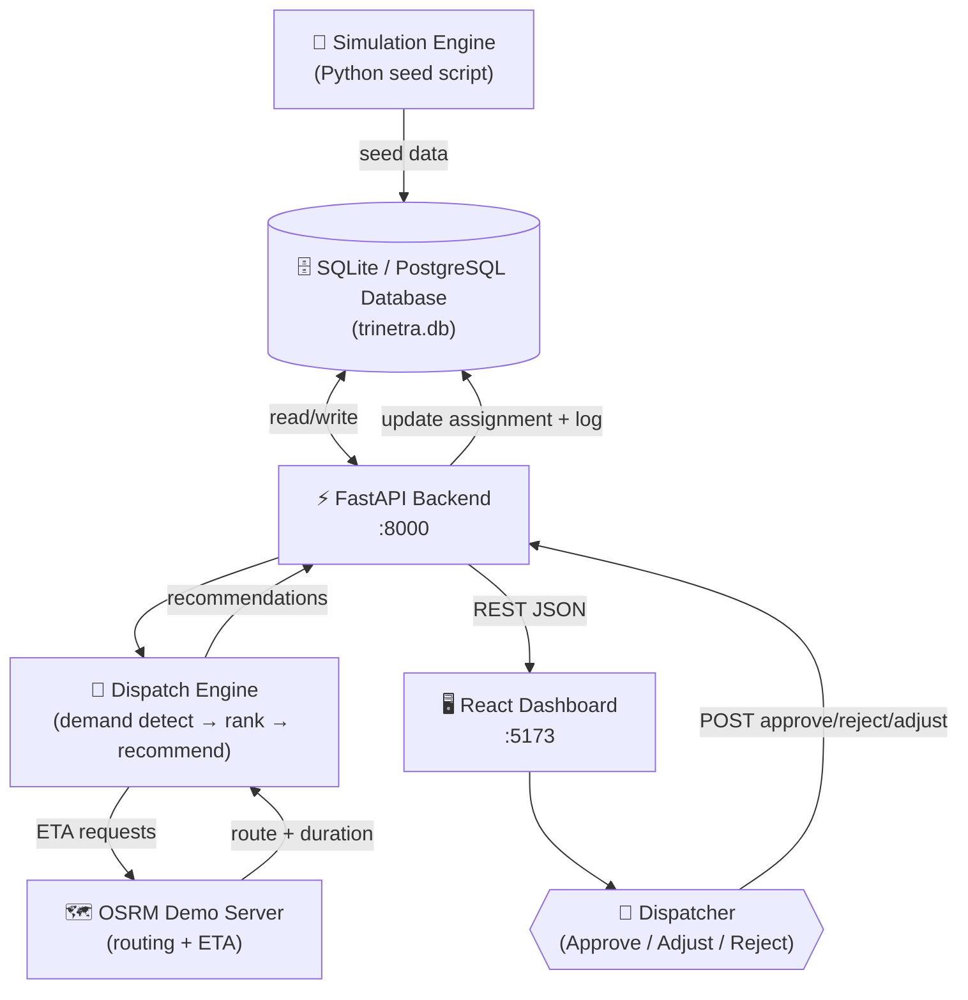

# TRINETRA Architecture

## System Architecture

### Layers:
1. **Demand Signal Layer**: Queues, ticket/booking requests, historical baseline records.
2. **Data Platform Layer**: SQLite (local) / Supabase PostgreSQL (production), schema version migrations.
3. **Decision Engine Layer**: Demand surge detection, candidate filtering, route estimation, composite scoring, and waiting-time reduction estimation.
4. **Dispatch Control Layer**: React Leaflet dashboard with live status markers, approval controls, and audit log.

